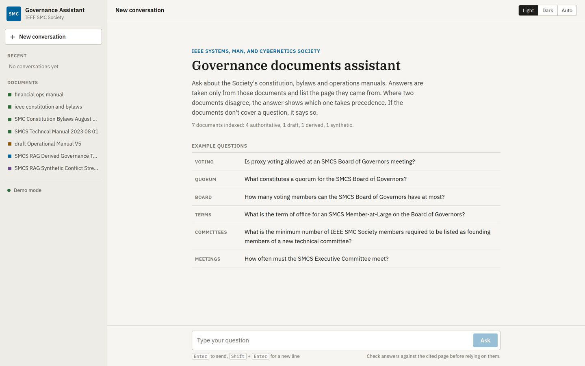
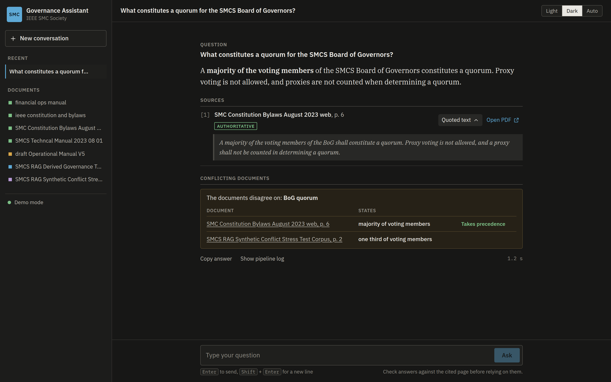
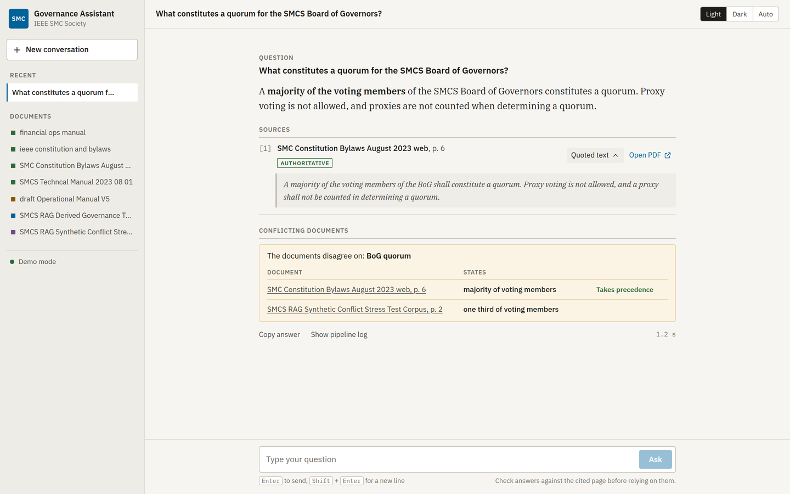
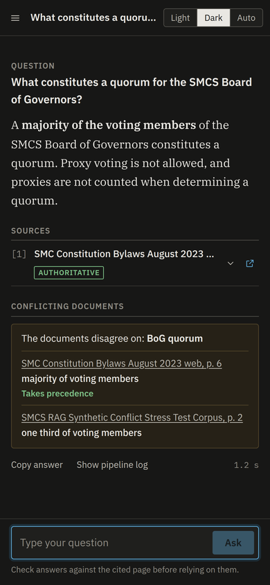

# Final Testing

IEEE SMCS governance RAG chatbot: the retrieval pipeline (`src/`), its
evaluation (`evaluation/`), and a web interface (`web/`).

## Web interface

A browser front end for the chatbot. It calls the same pipeline as
`src/rag_chat.py` (unchanged) and shows each answer with its cited source,
a link to the exact PDF page, any detected rule conflicts with the
document that takes precedence, and the full pipeline log. It has light,
dark and automatic themes, saves conversations in the browser, and works
on phones. The page loads nothing from the internet (fonts are bundled).

| Light | Dark |
| --- | --- |
|  |  |
|  |  |

### Requirements

- Python with a virtual environment
- [Ollama](https://ollama.com) with the `llama3` model (`ollama pull llama3`)
- A built vector database in `chroma_db/` (run `python src/ingest.py` once)

### Setup (Windows, first time)

Run these in PowerShell from the project folder:

```powershell
python -m venv venv
venv\Scripts\activate
python -m pip install -r requirements-lock.txt
```

`requirements-lock.txt` pins the exact versions of a known-working setup.
`requirements.txt` lists only the direct dependencies, without versions.

On macOS/Linux, activate with `source venv/bin/activate` instead.

### Run

1. Start Ollama (open the Ollama app, or run `ollama serve`).
2. Activate the virtual environment: `venv\Scripts\activate`
3. Start the server with the same Python that runs `rag_chat.py`:

   ```powershell
   python web\server.py
   ```

4. Wait for `Pipeline ready in …s` in the terminal (the first start can
   take a few minutes while the embedding model downloads).
5. Open http://localhost:8000. The sidebar status turns green (**Ready**)
   when it can answer. Questions asked earlier wait and are sent
   automatically.

Press **Ctrl + C** in the terminal to stop it.

### Using it in another project folder

Copy the `web/` folder into the folder that holds your RAG files (for
example `RAG/`) and run `python web\server.py` from that folder. The
server works out the paths itself:

- `rag_chat.py` can be in `src/` or directly in the folder
- `chroma_db/` and `data/` (the PDFs) are expected in the folder

On start-up it prints the Python executable and the paths it is using, and
flags anything missing. To point it at a folder explicitly, set
`RAG_PROJECT_DIR` (PowerShell: `$env:RAG_PROJECT_DIR="E:\RAG"`).
Set `PORT` to use a port other than 8000.

### Demo mode

To preview the interface without Ollama or the vector database (canned
responses):

```powershell
$env:RAG_DEMO_MODE="1"; python web\server.py
```

### Troubleshooting

| Problem | Fix |
| --- | --- |
| "The assistant is still loading" | The models are still loading. Wait for `Pipeline ready` in the terminal; questions now wait automatically. |
| "Missing packages in this Python environment" or "Could not import chromadb" | The server is running on a different Python from your project. Activate the venv and start it with `python web\server.py`, not `uvicorn`. The message prints the exact `pip install` command for the Python in use. |
| `cannot import name '_ExtendedAttributes' from 'opentelemetry.util.types'` | OpenTelemetry packages are on mismatched versions. Run `python -m pip install -r requirements-lock.txt`, or upgrade them together: `python -m pip install --upgrade opentelemetry-api opentelemetry-sdk opentelemetry-proto opentelemetry-exporter-otlp-proto-grpc opentelemetry-exporter-otlp-proto-common` |
| `chroma_db ... (NOT FOUND - run ingest first)` | Build the database: `python src\ingest.py` from the project folder. |
| Every answer says "Not covered by the documents" | `chroma_db/` is empty or in a different folder. Check the paths printed at start-up. |
| Page shows "Offline" | The server terminal was closed. Start it again. |
| `Address already in use` | Use another port: `$env:PORT="8001"; python web\server.py` |

Check for other package conflicts with `python -m pip check`.

### Files

| File | Purpose |
| --- | --- |
| `web/server.py` | FastAPI app: `/api/chat`, `/api/health`, `/api/documents`, serves PDFs under `/files/` |
| `web/static/index.html` | Page layout |
| `web/static/styles.css` | Styling, light/dark themes, mobile layout |
| `web/static/app.js` | Chat logic, conversation history (saved in the browser), source and conflict cards |
| `web/static/fonts/` | IBM Plex fonts (SIL Open Font License), bundled so the page works offline |

## Secrets

Copy `.env.example` to `.env` for any local secrets. `.env` files are
ignored by git and must never be committed or shared. The pipeline itself
does not currently read any token.
