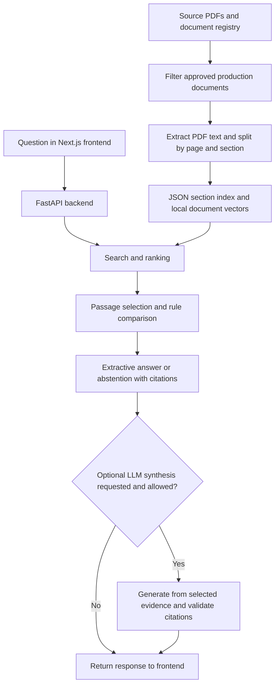
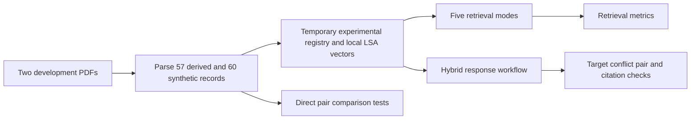

# Methodology: Jueun's Implementation

Team review draft — 15 October 2026

This document describes Jueun Yoo's implementation and its saved development experiment. It is a candidate method for team comparison, not a claim that the team has selected its final method. Student names indicate the implementation described here; final writing and review contributions should be recorded separately.

The method description was checked against the current repository. The reported results come from the saved `before` and `after` runs in `experiment_outputs/text_only_20260909`. All four code hashes recorded in the `after` manifest match the current corresponding files. The benchmark was not rerun when preparing this draft. Historical hardware and complete runtime details are not recorded in that manifest.

## 3.1 Research Approach (Jueun Yoo)

The work follows a Design Science Research approach: identify a practical problem, build a working system, evaluate it, and use the findings to improve it. The problem is to help users find relevant SMCS governance information and review rules that may conflict, with sources they can check.

We developed the chatbot in stages and used quantitative tests to examine retrieval and conflict reporting. Failed cases helped us identify changes to query matching, ranking, passage selection, and rule comparison. We then compared the saved results before and after these changes using the same development documents and questions.

This is a development evaluation rather than an independent final test. The cases were inspected during refinement. The results show how the implementation performed on these cases, but do not establish its performance on unseen questions or all SMCS policies. Adapted Scrum describes the team's project management process; it is separate from this research approach.

## 3.2 Research Questions and Hypotheses (Jueun Yoo)

The questions below reflect the implemented tests. The expectations organise the evaluation; they should not be presented as preregistered hypotheses or statistically confirmed findings.

| Research question | Measurable expectation | Evaluation |
|---|---|---|
| RQ1: Can query matching and hybrid ranking improvements help retrieve relevant passages when questions use different wording? | The updated hybrid method achieves higher Recall@5 and MRR@10 on paraphrased questions than the earlier version. | Compare 15 paraphrased questions before and after refinement. |
| RQ2: Can the system identify selected potential conflicts when the required passages are available? | Updated comparison rules detect more of the intended conflict pairs without flagging the identical and distractor controls. | Directly supply 20 scenarios in four pair variants. |
| RQ3: Do these improvements help the complete retrieval-to-response workflow report the intended conflict? | More responses include the intended pair within a reported conflict after refinement. | Compare 20 hybrid chatbot responses before and after refinement. |

The experiment also compares deterministic, BM25, dense, RRF, and hybrid retrieval on the same records. Here, “dense” means the vector-only retrieval mode using local LSA, not a neural embedding model. Multiple changes were made between stages, so the before-and-after comparison does not isolate the contribution of each change.

## 3.3 System Architecture/Design (Jueun Yoo)

### Main application

The application has a Next.js/React frontend and a Python FastAPI backend. A registry records source identity, version, approval status, authority, and retrieval eligibility. The production ingestion service reads approved production PDFs and builds a JSON section index. Search and response services then use this index to answer questions.



The registry allows production retrieval only when `usage=production`, `approval_status=approved`, and `retrieval_enabled=true`. The configured production authority order is IEEE Constitution and Bylaws (100), SMCS Constitution and Bylaws (90), Corrected Operations Manual (80), and SMCS Technical Manual (70). This configuration is not itself proof of official approval or applicability; source metadata still needs governance verification.

Within-document conflicts cannot be resolved by choosing a higher-authority document. These cases retain the competing evidence and require human review. Cross-document handling distinguishes supported hierarchy-based resolution from potential conflicts that still require review.

### Experimental architecture

The reported benchmark uses the same search and response service classes with a separate in-memory experimental registry and 117 prepared records. It does not rebuild the production index or add synthetic records to ordinary production retrieval.



## 3.4 Data Collection Methods (Jueun Yoo)

The project uses document data rather than participant responses. The main application uses the supplied IEEE/SMCS document collection. The experiment reported here uses two development PDFs:

- `SMCS_RAG_Derived_Governance_Test_Corpus.pdf`
- `SMCS_RAG_Synthetic_Conflict_Stress_Test_Corpus.pdf`

The derived corpus supplies source-grounded governance records. The synthetic corpus supplies scenarios containing a baseline rule, a conflicting rule, and an unrelated distractor. The experiment loads these prepared documents; the benchmark code does not create the PDF variants itself. The authorship and expert-review history of these materials should be confirmed before final submission.

| Data component | Count | Use |
|---|---:|---|
| Canonical derived records | 57 | Source-grounded retrieval targets |
| Synthetic records | 60 | Three records for each of 20 scenarios |
| Total indexed experimental records | 117 | Shared retrieval collection |
| Title-based questions | 57 | Questions closely related to record headings |
| Paraphrased questions | 15 | Questions with different wording |
| Conflict questions | 20 | Questions requiring both target records |

The derived parser extracts canonical records from PDF pages 2–9 and loads the associated question bank separately. It excludes repeated expanded material and question-answer sections from indexed evidence. The synthetic parser removes expected-behaviour notes and test instructions before indexing. Assertions check that selected answer and instruction markers are absent from record text.

Text is extracted using `pypdf`. No OCR or financial manual is included in this experiment. Records retain identifiers, source labels, page information, and experimental authority metadata. Synthetic record IDs act as virtual document IDs so that different rules can be compared as separate documents. Their approval and authority values are test assumptions, not official policy status.

This collection is referred to as a development golden set. Expert validation of its expected answers, relevant-record IDs, and conflict labels has not been established by the saved experiment records. It is separate from the application's Operations Manual evaluation workbook and any separate 50-case holdout.

## 3.5 Implementation Details (Jueun Yoo)

| Component | Implementation used or supported |
|---|---|
| Backend | Python, FastAPI, Pydantic |
| Frontend | Next.js, React, TypeScript, CSS |
| PDF extraction | `pypdf` |
| Production index | JSON section records with source metadata |
| Experimental index | Parsed records supplied in memory |
| Experiment embeddings | scikit-learn TF-IDF and TruncatedSVD, with NumPy vectors |
| Retrieval | Deterministic lexical scoring, BM25, vector similarity, RRF, and hybrid scoring |
| Conflict processing | Custom rule-based checks and authority-aware response handling |
| Optional generation | Configurable OpenAI or Ollama integration; not evaluated in this benchmark |
| Experiment outputs | JSON manifests, rankings, records, pair tests, and responses |

### Parsing and embeddings

Production ingestion splits PDF text using page and section/clause headings, preserving source metadata. The reported benchmark instead uses canonical record boundaries. It does not use a fixed 1,500-character/200-character-overlap LangChain splitter.

The benchmark explicitly selects `local_lsa`. Text is represented with TF-IDF word unigrams and bigrams, then reduced using TruncatedSVD with a fixed random state of 0 and a target of up to 128 dimensions. Vectors are normalised for similarity calculations. The input includes available section and heading text as well as record content.

The application also supports explicitly configured sentence-transformer and Ollama embeddings. Those options are not the embedding method used for the recorded results. The presence of ChromaDB or LangChain in repository dependencies does not mean this experiment uses them as its retrieval implementation.

### Query matching and ranking

Hybrid query expansion maps selected expressions to governance terms, such as “minimum attendance” to “quorum” and delegated voting to “proxy voting.” The hybrid base score is:

`0.35 × normalised BM25 + 0.35 × vector similarity + 0.20 × lexical score + 0.10 × heuristic reranking score`

Additional topic-specific adjustments and penalties can affect the final ranking. This formula therefore describes the base combination, not every ranking decision. Reranking uses hand-written lexical signals rather than a trained cross-encoder. The RRF mode combines independent BM25 and vector ranks with a rank constant of 60.

### Evidence selection, conflict comparison, and responses

The response workflow initially retrieves up to ten candidates. Explicit conflict questions can trigger additional bounded searches using passages from the initial results. Passage selection preserves nearby sentences for conflict-related queries, subject to a character limit, to reduce loss of conditions.

Rule comparison checks selected topics, quantities, roles, obligations, permissions, approval order, qualification substitutions, and exceptions. Some guards avoid treating different conditions or negated alternatives as contradictions. These are targeted heuristics, not a general legal reasoning engine.

The non-LLM response path returns extracted evidence, a conflict explanation, or an abstention. Citations are formed from source metadata and checked against retrieved records. Optional LLM synthesis uses selected evidence and falls back to the hybrid response when unavailable or invalid. Citation validation does not prove that every generated statement is logically supported.

### Execution environment

The saved manifest records the local LSA backend and source/code hashes, but not the historical machine specifications, complete installed package versions, or Python version. These details should be recovered from the original run environment before final submission. Current dependency files describe the repository environment, not necessarily the historical experiment environment.

## 3.6 Experimental Design (Jueun Yoo)

The experiment has three parts.

**Retrieval comparison:** The 57 title-based, 15 paraphrased, and 20 conflict questions are each evaluated with five retrieval modes. This produces 92 × 5 = 460 retrieval cases per stage. Each query requests up to ten results. Relevant-record IDs are used for scoring after retrieval and are not supplied as query answers.

**Direct pair tests:** Each of 20 scenarios is tested in four variants: the intended cross-document conflict pair, the same pair assigned the same document identity, an identical-text control with a different identity, and a baseline-plus-distractor control. This produces 80 checks per stage. The complete record texts are supplied directly to the conflict detector, bypassing retrieval and normal passage selection.

**Complete hybrid response tests:** The 20 conflict questions are submitted through `RAGService.answer` in hybrid mode. A case succeeds when a reported conflict includes both intended virtual document IDs. A separate check verifies the returned top-level citations against indexed text and page metadata.

| Variable type | Definition |
|---|---|
| Changed conditions | Before/after implementation stage; retrieval mode in retrieval comparisons |
| Measured outcomes | Retrieval ranks, relevant-record recall, pair coverage, conflict reporting, citation checks, and retrieval time |
| Shared conditions | The same source documents, question sets, target IDs, experimental records, and metric definitions |

The before-and-after update includes several changes together: query expansion, ranking adjustments, condition-comparison rules, and evidence selection. It is therefore a combined refinement comparison rather than an isolated test of each change. Multiple runs, random sampling, or statistical significance testing are not documented. Retrieval timing is recorded, but cache behaviour and runtime conditions do not support a strong speed claim.

## 3.7 Evaluation Metrics (Jueun Yoo)

| Metric | Definition and interpretation |
|---|---|
| Recall@5 | Relevant target IDs found in the top five divided by the number of target IDs, averaged over questions. For single-target questions this is a hit rate; for conflict questions it measures coverage of two targets. |
| Pair hit@5 | Fraction of questions with every target ID in the top five. For conflict questions, both targets must be present. |
| MRR@10 | Mean reciprocal rank of the first relevant target in the top ten; zero if none is found. It does not require both conflict targets. |
| nDCG@10 | Rank-discounted gain for relevant IDs in the top ten, normalised against their ideal order using binary relevance. |
| Direct conflict detection | Whether the detector reports a conflict when given the prepared pair. Counts are reported separately for each positive and negative variant. |
| Target conflict reporting rate | Number of full hybrid responses containing a conflict with both intended virtual document IDs divided by 20. This is not overall answer accuracy. |
| Citation verification | Whether nonempty returned citations match an indexed record's identity and page and contain evidence text present in that record after whitespace normalisation. |
| Retrieval latency | Elapsed time around each search call in milliseconds. This is descriptive, not a controlled hardware benchmark. |

RAGAS faithfulness, LLM answer usefulness, human agreement, and general answer accuracy are not measured by this experiment. A valid evidence-text citation is not proof of full semantic correctness. Target-pair success also does not measure every extra conflict a response might report.

## 3.8 Validation Methods (Jueun Yoo)

Validation separates retrieval errors from comparison errors. Direct pair tests show whether the detector can identify the selected scenario when evidence is available. Full response tests then examine the retrieval, passage selection, filtering, comparison, and response process together. Identical-text and distractor controls check for selected false alarms.

The benchmark records source SHA-256 hashes and hashes of four relevant code files. Each stage stores the questions, scenarios, indexed records, top-ten rankings, pair results, full responses, and summaries. Stage folders cannot be overwritten by default. The saved `after` code hashes match the current files checked for this draft, although that does not establish a complete reproducible historical environment or verify all dependencies.

Regression tests cover authority conflicts, policy claims and exceptions, hybrid retrieval, the response workflow, and caching. The saved progress material reports 75 passing regression tests. This draft does not claim a fresh test run. No expert user study, cross-validation, inter-rater agreement analysis, or independent final holdout result is established by this benchmark.

## 3.9 Ethical Considerations (Jueun Yoo)

The chatbot supports information finding and policy review. It is not an authorised interpreter of IEEE/SMCS rules. Incorrect or incomplete guidance could affect a user's decision, so the system should show its evidence, communicate uncertainty, and request human review where appropriate.

Synthetic scenarios must remain clearly labelled and separate from official policy. Experimental authority values do not turn fictional rules into approved guidance. Expert review is needed to establish whether expected answers and conflict labels correctly reflect the relevant rules and context.

This evaluation uses documents and synthetic cases rather than participant responses. The repository evidence reviewed here does not establish a formal ethics approval or exemption. The applicable course and university requirements should be confirmed before making such a statement, and before conducting future user studies. Document access and redistribution permissions also need to be respected.

## 3.10 Data Security/Privacy (Jueun Yoo)

The production registry separates approved retrieval material from pending documents, audit inputs, and evaluation-only data. The experiment uses a temporary adapter and does not modify those production boundaries. This separation reduces the risk of test answers or fictional rules appearing in ordinary chatbot evidence.

The evaluated retrieval and rule-based workflow runs locally without external model calls. The application separately supports optional cloud synthesis, which can send the question and selected evidence to the configured provider. Local Ollama integration is also available. These options should be disclosed according to the configuration actually used; the whole application should not be described as always offline.

API keys are read from the environment. Debug retrieval is development-only, and production configuration disables evaluation endpoints by default. However, these controls do not establish complete security. Authentication, authorisation, deployment protections, retention policies, and logging of sensitive content require a separate verified assessment. They are not validated by the retrieval experiment. Before sharing benchmark outputs, the team should check document permissions and whether stored passages contain restricted information.

## 3.11 Sustainability (Jueun Yoo)

The implementation reuses local document representations and includes bounded query-score and response caches to avoid repeated work. The non-LLM modes can return evidence without running a generative model for every question. These features can reduce unnecessary processing, but the experiment does not measure energy consumption or carbon emissions.

Separate ingestion, search, conflict, response, and evaluation modules support maintenance. Source metadata, saved experiment outputs, and regression tests help future developers inspect changes. Controlled index rebuilding can support document updates, but an automatic monitoring or full document-version archive workflow should not be claimed without separate implementation evidence.

## 3.12 Limitations (Jueun Yoo)

The main limitation is the development dataset. The same questions and failures informed the refinements, so improved results do not demonstrate independent generalisation. The title-based questions are relatively easy, and synthetic scenarios cover selected conflict patterns. They do not represent the full range of real governance questions.

The golden set also needs expert review. The system's expected labels and synthetic authority assumptions cannot establish the correct interpretation of real policies. Judging retrieval by target IDs may penalise a different passage that expresses equivalent information.

The response process compares retrieved passages and some neighbouring sentences rather than reviewing the complete document. It can miss an exception or explanation elsewhere. Selected guards account for some conditions, but do not provide a complete understanding of how all clauses interact. This creates a risk of both missed conflicts and false alarms. The evaluated negative controls are too narrow to establish a real-world false-positive rate.

The rule-based detector has limited flexibility for unseen wording and unfamiliar policy relationships. Local LSA is also a relatively simple semantic representation. The experiment does not compare modern neural embedding models or evaluate optional LLM generation quality.

The complete workflow still misses four of the 20 intended conflict pairs after refinement. Direct-pair success therefore must not be reported as 100% chatbot reliability. Citation-text verification similarly does not establish overall answer correctness. Historical environment details and controlled repeated timing measurements are incomplete.

---

# Team Comparison Appendix — Recorded Results

This appendix supports method selection. Move these numerical findings to the Results chapter in the final report. They are saved development results, not a new run or an independent test.

## A. Before-and-after hybrid results

| Measure | Before | After |
|---|---:|---:|
| Title-based target in top five | 57/57 (100%) | 57/57 (100%) |
| Paraphrased target in top five | 9/15 (60.0%) | 13/15 (86.7%) |
| Paraphrased MRR@10 | 0.443 | 0.739 |
| Both conflict targets in top five | 10/20 (50%) | 14/20 (70%) |
| Direct cross-document conflict detection | 17/20 | 20/20 |
| Direct same-document conflict detection | 17/20 | 20/20 |
| Identical-text controls flagged | 0/20 | 0/20 |
| Distractor controls flagged | 0/20 | 0/20 |
| Full hybrid response reports intended conflict pair | 14/20 (70%) | 16/20 (80%) |
| Responses passing recorded citation-text verification | 20/20 | 20/20 |

Remaining full-workflow misses: scenario 01 (BoG quorum), 09 (President-Elect eligibility), 15 (New TC approval), and 20 (Governance hierarchy).

## B. Retrieval-mode comparison: saved after stage

| Mode | Title questions: Recall@5 | Paraphrases: Recall@5 | Paraphrases: MRR@10 | Conflict target Recall@5 | Both conflict targets in top five |
|---|---:|---:|---:|---:|---:|
| Deterministic | 70.2% | 53.3% | 0.297 | 70.0% | 55% |
| BM25 | 100% | 66.7% | 0.470 | 65.0% | 50% |
| Dense (local LSA) | 100% | 60.0% | 0.422 | 55.0% | 20% |
| RRF | 100% | 66.7% | 0.408 | 62.5% | 35% |
| Hybrid | 100% | 86.7% | 0.739 | 82.5% | 70% |

Hybrid performs best on the saved paraphrase and conflict-pair retrieval measures in this table. Its advantage is observed on development cases used for refinement; the comparison does not prove it is the best method on unseen data. The 82.5% target recall and 70% pair success measure different things and must not be interchanged.

## C. Comparing with another team implementation

Use shared documents, eligible sources, unseen questions, target evidence, and scoring rules. Compare retrieval first, then conflict and abstention behaviour, and then LLM answer quality if both methods are configured for generation. State differences in embedding models, hardware, and model calls. Prefer expert-reviewed targets and include realistic non-conflict cases.

The results here cannot be directly ranked against another method's 50-question answer accuracy or full-pipeline pass rate. Different datasets and success definitions must be aligned first. No final team method is selected by this document.

## D. Evidence and reproduction

Repository-relative evidence locations:

- `experiments/text_only_benchmark.py`: benchmark construction and execution.
- `experiments/new_corpus_stress_test.py`: shared scenario parser, experimental registry, and metric definitions.
- `experiment_outputs/text_only_20260909/before/`: saved baseline results.
- `experiment_outputs/text_only_20260909/after/`: saved updated results, rankings, responses, and manifest.
- `experiment_outputs/text_only_20260909/REPORT_KO.md`: development findings and caveats.
- `backend/services/search_service.py`: query expansion and retrieval modes.
- `backend/services/embedding_service.py`: local LSA and optional embedding backends.
- `backend/services/rag_service.py`: evidence selection, conflict reporting, abstention, and optional synthesis routing.
- `backend/services/policy_claim_service.py`: targeted conflict comparison rules.
- `backend/services/ingest_service.py` and `registry_service.py`: production ingestion and source eligibility.
- `backend/services/llm_service.py`: optional generation and citation safeguards.
- `frontend/package.json`: frontend framework dependencies.

To run the current benchmark, use a new stage name so the saved evidence remains intact. This reproduces the current method, not the historical pre-change code. Run from the repository root with the required local PDFs and installed dependencies:

```bash
OPENBLAS_NUM_THREADS=1 ./venv/bin/python -m experiments.text_only_benchmark --stage team_review_verification
```

Relevant regression suite:

```bash
./venv/bin/python -m unittest tests.test_policy_exceptions tests.test_policy_claims tests.test_authority_conflicts tests.test_vertical_slice tests.test_hybrid_rag tests.test_response_cache -q
```

Before final submission: confirm dataset authorship and expert-review status, recover original execution environment details, add verified academic references for the research framework and retrieval methods, and record actual implementation/writing/review contributions.
